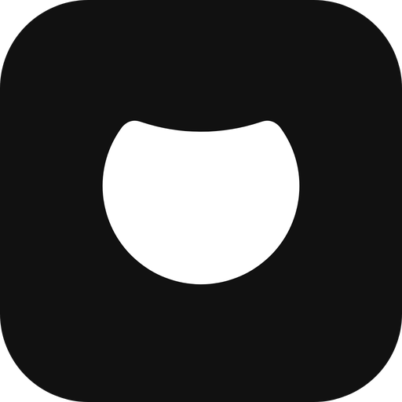
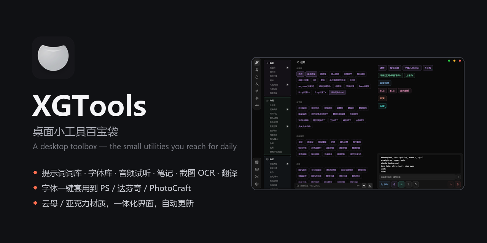
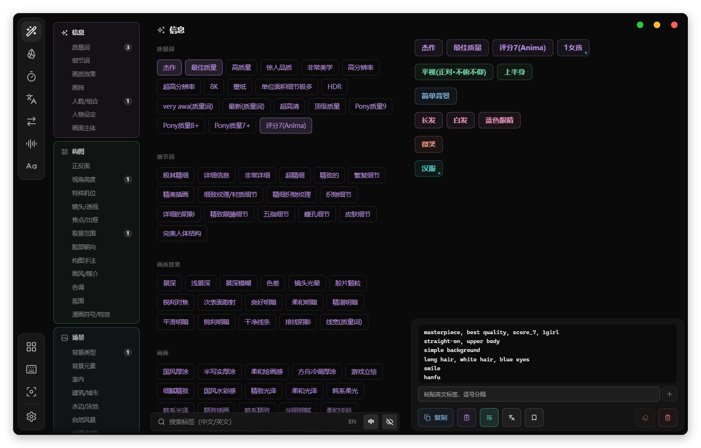
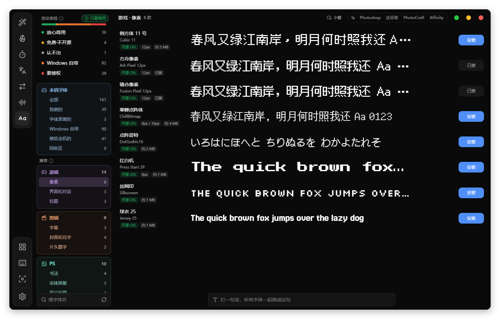
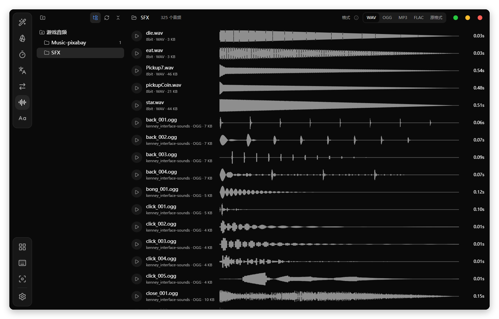
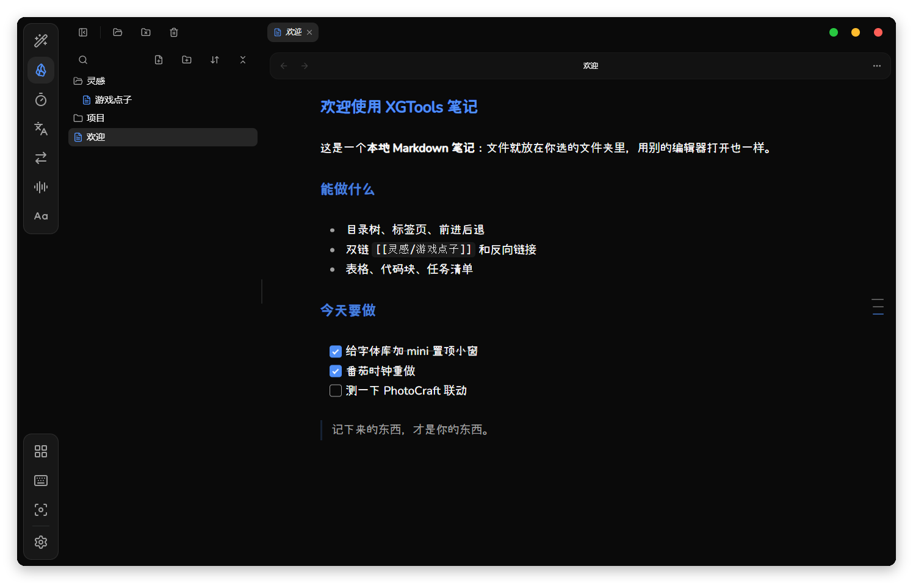
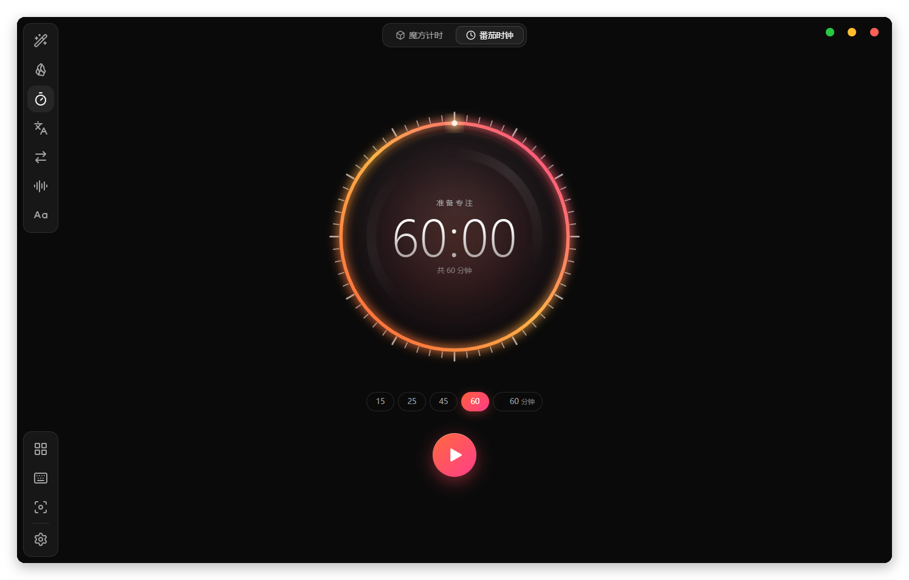

[English](README.md) | 官话 - 简体中文 | [官話 - 繁體中文](README-cmn_TW.md) | [廣東話](README-jyut.md)

<br>

<p align='center'>
  
</p>

<h1 align='center'>XGTools</h1>

<p align='center'>
  <samp>桌面小工具集 —— 每天要用一下的那些小工具，收进一个图标</samp>
</p>

<p align='center'>
  
  
  
  
  
  
</p>

<p align='center'>
  <a href="https://github.com/XXGGG/XGTools/releases">下载</a>
</p>

<br>

## 👋 简介

XGTools 把每天要用一下的小工具 —— 提示词词库、字体库、音频试听、Markdown 笔记、计时器、
翻译、格式转换、带 OCR 的截图、启动台 —— 收进托盘里的一个图标，不用一个功能装一个软件。

这是一个自用工具，为一台 Windows 电脑做的，原样分享出来。

> [!IMPORTANT]
> **v0.16.0 —— 下面列的都能用，除了这几样：**「键盘桌宠」页目前只有按键显示，桌宠本身还没做；
> 字体「套用到 Affinity」接好了连接，还没做完。

<div align="center">
  
</div>

<div align="center">
  
</div>

## ✨ 有什么不一样

**一整块界面，不是一摞卡片。** 页面直接铺在窗口的云母 / 亚克力材质上，只有左边导航栏和顶部页签
是面板，而且也是通透的。列表滚到边上是渐隐，不是被卡片边框一刀切掉。

**会跟别的软件联动的字体库。** 点一款字，Photoshop、达芬奇（Fusion 的 Text+）、PhotoCraft
里选中的文字就换成它。字体装进 Windows 的个人字体文件夹，跟右键「安装」一模一样，所有软件都认；
还有一个置顶的 mini 小窗，把常用的字放在你正在做图的软件旁边。每款字都会读协议，告诉你能不能
打包进游戏、用在视频里、做图印刷。

<div align="center">
  
</div>

**给二次元模型准备的提示词词库。** 约 2250 个 Danbooru 标签、139 个小类，按层上色（质量、
镜头、场景、人物、服装、动作……），按语义去重，搜索认同义词。自然语言窗口把中文描述整理成
Anima 这类模型吃的英文句子；常用组合可以存成预设。

**自己会更新。** 新版本发在 GitHub Releases，软件启动时检查，一键下载安装（带签名校验，
被改过的安装包会被拒绝）。

<div align="center">
  
</div>

## 🚀 开始用

到 [Releases](https://github.com/XXGGG/XGTools/releases/latest) 下载安装包 —— 装好以后，
更新都在软件里完成。也可以自己构建：

```bash
pnpm install

# Format conversion needs ffmpeg — drop ffmpeg.exe and ffprobe.exe into
# src-tauri/resources/ffmpeg/  (https://github.com/BtbN/FFmpeg-Builds/releases)

pnpm tauri dev      # development
pnpm dist           # installer -> installer/
```

环境要求：Node.js 18+、Rust 1.77+、pnpm，Windows 10/11 —— 好几个功能直接调 Win32 API，没有跨平台的路。

## 📦 都有什么

| | |
|---|---|
| **提示词** | Danbooru 标签词库，分层配色、搜索、预设，还有自然语言 → 提示词窗口 |
| **笔记** | 本地 Markdown 笔记：标签页、反向链接、历史版本、画布 |
| **字体库** | 协议体检、一键安装、套用到别的软件、mini 小窗、整行拖出字体文件 |
| **音频试听** | 音效库波形浏览：裁剪、转格式、直接拖进项目 |
| **计时器** | 空格键操作的魔方计时，加一个切页面也不停的番茄时钟表盘 |
| **翻译** | 离线（Bergamot）或在线引擎，也能接任何 OpenAI 兼容的大模型 |
| **格式转换** | 图片、音频、视频，用内置的 ffmpeg |
| **启动台** | 全屏应用网格，拖动排序，文件夹换图标 |
| **截图** | 框选、标注、钉在屏幕上、录屏、OCR、原地翻译 |
| **命令面板** | 一个快捷键搜应用、笔记、文件，或者直接翻译 |

<div align="center">
  
</div>

<div align="center">
  
</div>

## 📁 结构

```
src/
  App.vue                    window routing + the floating chrome
  components/TitleBar.vue    teleport target for page tabs, window controls
  composables/               shared reactive settings (settings.json), updater
  lib/sidebar-prefs.ts       sidebar order/visibility reconciliation (pure, testable)
  lib/prompt/                prompt tag library, dedupe, synonyms
  views/                     one file per tool page
src-tauri/src/
  window_effects.rs          mica / acrylic, and the dark-mode attribute Windows needs
  font_commands.rs           font scan / install (per-user Fonts folder + shared ledger)
  font_apply.rs              apply a font to Photoshop / DaVinci Resolve / PhotoCraft
  *_commands.rs              screenshot, OCR, translate, convert, audio, launcher
```

## 🙏 致谢

**框架** —— [Tauri](https://tauri.app), [Vue.js](https://vuejs.org),
[Tailwind CSS](https://tailwindcss.com)
**界面** —— [shadcn-vue](https://www.shadcn-vue.com) (on [reka-ui](https://reka-ui.com)),
[Lucide](https://lucide.dev) 图标
**截图与 OCR** —— [xcap](https://github.com/nashaofu/xcap),
[PaddleOCR](https://github.com/PaddlePaddle/PaddleOCR),
[ONNX Runtime](https://onnxruntime.ai)
**输入与特效** —— [rdev](https://github.com/Narsil/rdev),
[window-vibrancy](https://github.com/tauri-apps/window-vibrancy)
**离线翻译** —— [Bergamot](https://browser.mt) 和 Mozilla 的翻译模型
**提示词标签** —— 标签名沿用 [Danbooru](https://danbooru.donmai.us)

应用图标是一个口袋，从零画的 —— **点子**来自哆啦 A 梦的四次元口袋，所有道具都是从里面掏出来的。
拿来当工具箱正合适。

README 版式参考 [vitesse](https://github.com/antfu-collective/vitesse) 和
[BewlyBewly](https://github.com/BewlyBewly/BewlyBewly)。

## 许可协议

[CC BY-NC-SA 4.0](https://creativecommons.org/licenses/by-nc-sa/4.0/deed.zh-hans) —— 可以自由使用、
修改和分享，需署名、**不可商用**、改编作品须用相同协议。

Copyright © 2026 [Xie Xiage](https://github.com/XXGGG)
